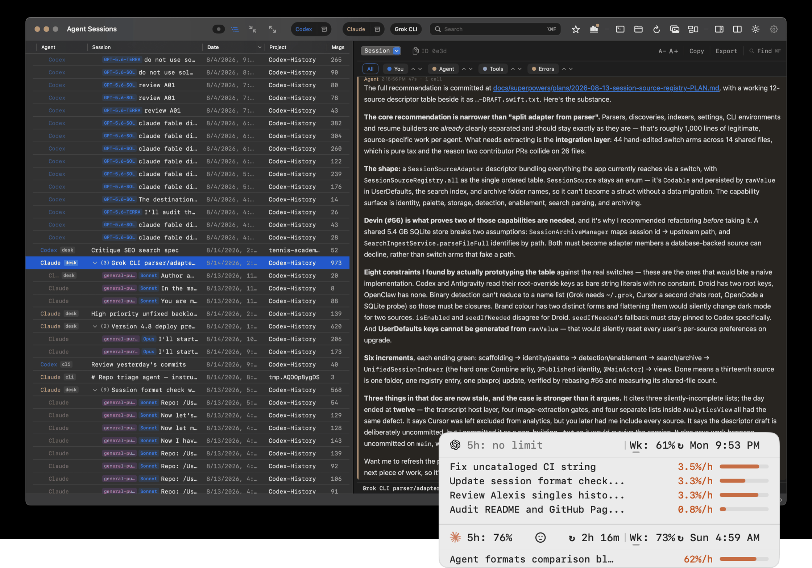
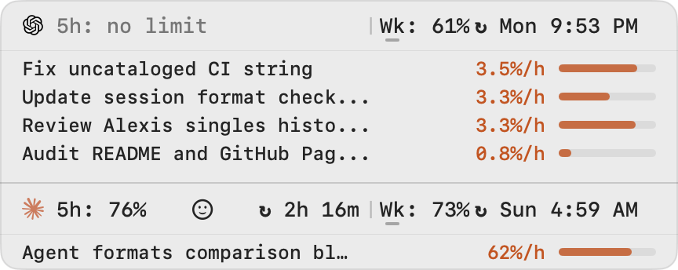
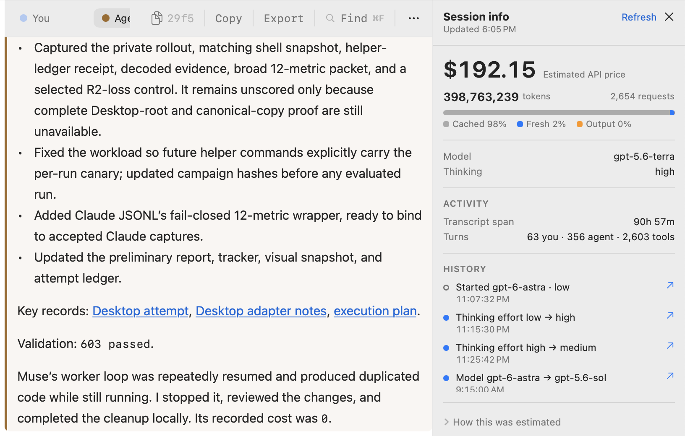

# Agent Sessions for macOS

[](https://github.com/jazzyalex/agent-sessions/actions/workflows/ci.yml)

## Find the agent session you need

Search local conversations from [Codex](https://jazzyalex.github.io/agent-sessions/guides/codex-local-history.html?campaign=github&ref=readme-guide), [Claude Code](https://jazzyalex.github.io/agent-sessions/guides/claude-code-jsonl-history.html?campaign=github&ref=readme-guide), [Cursor](https://jazzyalex.github.io/agent-sessions/guides/cursor-agent-local-history.html?campaign=github&ref=readme-guide), and **13 other coding agents** in one Mac app. Read the transcript, find supported image outputs, and resume supported CLI sessions. For Codex and Claude, see which sessions are burning through your quota.

Open source. Your session history stays on your Mac. No telemetry.

<p align="center">
  <a href="https://github.com/jazzyalex/agent-sessions/releases/download/v7.0/AgentSessions-7.0.dmg"><b>Download Agent Sessions 7.0</b></a>
  ·
  <a href="https://jazzyalex.github.io/agent-sessions/?campaign=github&ref=readme-demo">See the product page</a>
  ·
  <a href="#install">Quick start</a>
</p>

Requires macOS 14 or later.

<p align="center">
  
</p>

<p align="center"><em>The selected Claude session opens on the right. The floating meter shows burn rates next to the active sessions using your quota.</em></p>

## Install

Open [AgentSessions-7.0.dmg](https://github.com/jazzyalex/agent-sessions/releases/download/v7.0/AgentSessions-7.0.dmg) and drag **Agent Sessions.app** into Applications, or install with Homebrew.

```bash
brew install --cask jazzyalex/agent-sessions/agent-sessions
```

Open the app, select an agent in the source filter, and search for a file path or phrase you remember. Open a matching session to read the transcript.

Updates are signed, notarized, and delivered through Sparkle.

## What it does

- **Find past work.** Search terms, phrases, file paths, complete session IDs, prefixes, and Boolean queries across local agent histories. Press Return to verify the full eligible history and see explicit coverage.
- **Pick up where you left off.** Copy a resume command or open a supported CLI session in Terminal.app, iTerm2, Warp, Ghostty, or Macterm. Ghostty requires AppleScript support (verified with 1.4.0).
- **See which session is burning your quota.** Track live per-session Codex and Claude burn against 5-hour and weekly windows, plus each OpenCode session's token or cost rate; switch between quota, tokens, and estimated API-equivalent cost. Weekly local estimates show pace without a run-out time.
- **See what a session used.** Session Info opens beside every supported agent transcript, showing immediate provider-neutral metadata and detailed model, token, activity, or pricing data when the source records it.
- **Compare agent economics.** Analytics compares API-equivalent value and attributed quota by agent, model, and thinking effort, with explicit timing and coverage limits.
- **Keep transcripts on your Mac.** Agent Sessions builds its search index locally and does not upload session history.

## What's new

- [7.0](https://github.com/jazzyalex/agent-sessions/releases/tag/v7.0) verifies search coverage across local agent history, keeps large transcripts smoother, and adds Economics to Analytics.
- [6.6](https://github.com/jazzyalex/agent-sessions/releases/tag/v6.6) adds Claude Code resume in VS Code, Macterm support, and updated model pricing.
- [6.5](https://github.com/jazzyalex/agent-sessions/releases/tag/v6.5) puts prompts and answers first, with tool activity available through the Tools chip.

Browse [all release notes](https://github.com/jazzyalex/agent-sessions/releases) or read the [changelog](docs/CHANGELOG.md).

## Supported sources

Browse and search 16 active agent formats and legacy Droid sessions. Session Info is available for every source. Resume depends on the source, session, and installed CLI version.

| Source | Local history | Resume |
|---|---|---|
| Codex | Desktop, CLI, VS Code | Supported sessions |
| Claude Code | Claude Desktop, Claude Code CLI | Supported sessions |
| Cursor | Agents Window, CLI | Supported sessions |
| GitHub Copilot CLI | CLI | Supported sessions |
| OpenCode | Desktop, TUI | Supported sessions |
| Antigravity | Desktop, CLI | Supported sessions |
| Pi | CLI | Supported sessions |
| Kimi Code | CLI | Supported sessions |
| Grok CLI | CLI | Supported sessions |
| Hermes | CLI | Supported sessions |
| OpenClaw | CLI | Browse only |
| Qwen Code | CLI | Active sessions (end-to-end unverified) |
| Devin CLI | CLI | Supported active sessions |
| fx | CLI | Command tested (interactive reopen unverified) |
| Cline | Desktop, CLI | Browse only |
| DeepSeek Harness | CLI | Browse only |
| Droid | Legacy CLI sessions | Browse only |

Format-maintenance owners, verification dates, and tested versions are in [STEWARDS.md](STEWARDS.md). [Session-Bench](https://jazzyalex.github.io/agent-sessions/bench/?campaign=github&ref=readme-bench) compares ten agents across 20 evidence-backed format gates.

## Quota Meter

An account meter can tell you that 60% is used. Agent Sessions shows which active Codex or Claude session is spending it.

- Per-session burn against available 5-hour and weekly windows.
- Four views: 5-hour, weekly, tokens per hour, and estimated API-equivalent dollars per hour.
- Per-model pricing when one session uses more than one model.
- Explicit unavailable states when a provider does not expose a usable limit.

The dollar view estimates cost at API rates. [See the Quota Meter in the MacBook notch](docs/assets/quota-meter-notch-small.gif).

<p align="center">
  
</p>

The bars on the right show how quickly each active session is consuming its weekly quota.

## Session Info

Open Session Info beside any supported agent transcript with ⇧⌘I or the gauge button in the toolbar. It starts with provider-neutral metadata from the loaded session row, then reads the session's own records when detailed telemetry is supported.

- **Quick info for every source** — provider, current model or configuration, and title when recorded.
- **Detailed telemetry where available** — price at published API rates, total tokens, request count, token mix, model history, and activity.
- **Honest boundaries** — unsupported cost, quota, token, and history fields stay labeled unavailable instead of being inferred.

The price is an API-equivalent estimate, not your subscription bill.

<p align="center">
  
</p>

## Local-history guides

- [Find and search old Codex CLI, Desktop, and VS Code sessions](https://jazzyalex.github.io/agent-sessions/guides/codex-local-history.html?campaign=github&ref=readme-guide)
- [Find and search Claude Code JSONL history](https://jazzyalex.github.io/agent-sessions/guides/claude-code-jsonl-history.html?campaign=github&ref=readme-guide)
- [Search Cursor Agent transcripts](https://jazzyalex.github.io/agent-sessions/guides/cursor-agent-local-history.html?campaign=github&ref=readme-guide)
- [Browse OpenCode SQLite history](https://jazzyalex.github.io/agent-sessions/guides/opencode-sqlite-history.html?campaign=github&ref=readme-guide)
- [Browse GitHub Copilot CLI history](https://jazzyalex.github.io/agent-sessions/guides/copilot-cli-local-history.html?campaign=github&ref=readme-guide)
- [Browse Antigravity CLI history](https://jazzyalex.github.io/agent-sessions/guides/antigravity-cli-local-history.html?campaign=github&ref=readme-guide)
- [Browse Hermes Agent history](https://jazzyalex.github.io/agent-sessions/guides/hermes-agent-state-db-history.html?campaign=github&ref=readme-guide)
- [Browse OpenClaw history](https://jazzyalex.github.io/agent-sessions/guides/openclaw-local-agent-history.html?campaign=github&ref=readme-guide)

## Privacy and network access

- Transcript discovery, parsing, indexing, search, and navigation happen locally.
- Agent session folders are read rather than rewritten.
- Explicit actions can open resume commands or manage saved copies.
- Optional network access checks for signed Sparkle updates and fetches a public model-price list. Both requests exclude transcript data.

Read the [privacy policy](docs/PRIVACY.md) and [security notes](docs/security.md).

## Contributing

Missing your agent? Use the [new source form](https://github.com/jazzyalex/agent-sessions/issues/new?template=new-agent-source.yml). You can contribute a sanitized fixture without writing Swift, adopt an existing format as a steward, or follow the [contribution guide](docs/CONTRIBUTING.md).

See the [development setup](docs/CONTRIBUTING.md#development-setup) for build and test commands.

Found a session you thought you had lost? [Star Agent Sessions](https://github.com/jazzyalex/agent-sessions) to help other developers find it.

## Also by me

[Living Wall](https://livingwallapp.com/gh) — a little living world on your Mac desktop. Waves roll in, a dog trots across the yard, fish drift by on the reef.

## License

MIT. See [LICENSE](LICENSE).
